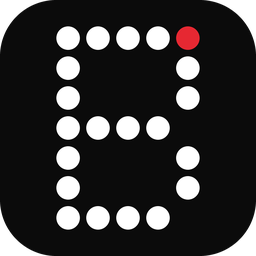
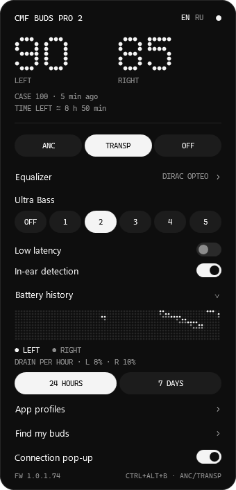
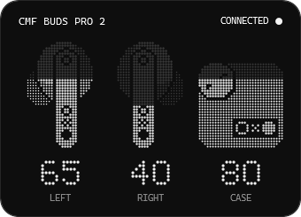
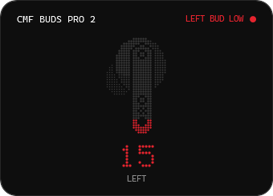

#  BudsTray

[](https://github.com/andr77eeeew/BudsTray/actions/workflows/ci.yml)
[](https://github.com/andr77eeeew/BudsTray/releases/latest)
[](https://github.com/andr77eeeew/BudsTray/releases)
[](LICENSE)


A small Windows tray app for the CMF Buds Pro 2: battery for the buds and the case, noise control, EQ and other settings. The icon appears only while the buds are connected, so the app stays out of the way the rest of the time.



 

## Download

Get the latest version from the [Releases page](https://github.com/andr77eeeew/BudsTray/releases/latest). There is nothing to install: download the `.exe` and run it.

| File | When to choose it |
| --- | --- |
| `BudsTray-win-x64.exe` | Recommended. Works on its own. |
| `BudsTray-win-x64-requires-dotnet.exe` | Smaller, but needs the [.NET 10 Desktop Runtime](https://dotnet.microsoft.com/download/dotnet/10.0). |

The files are not code-signed, so Windows SmartScreen may warn you the first time. Choose **More info**, then **Run anyway**. Each release includes `SHA256SUMS.txt` so you can verify the download.

## Features

- **Battery:** shows the left bud, right bud and case. The case reports its level only while the lid is open, so the panel shows the last known value and how old it is. The tray icon shows the lower of the two buds and turns red at 20% or below.
- **Connection pop-up:** when the buds connect, a card next to the tray animates in with the charge of each bud and the case. It doesn't take the focus from what you're doing.
- **Low battery alerts:** at 20% and 10%, a card names the bud that is running low. It warns again only after a real recharge and stays quiet while charging.
- **Time remaining:** estimates how long the charge will last, once the level has dropped at least 10% over 20 minutes of use. The estimate is rough because the buds report in 5% steps.
- **Battery history:** draws a dot-matrix chart for the last 24 hours or 7 days, with the average drain per hour.
- **Noise control:** switches between ANC (Low, Mid, High, Adaptive), Transparency and Off.
- **Sound and behaviour:** changes the EQ preset, Ultra Bass level, low latency mode and in-ear detection.
- **App profiles:** holds a chosen mode while a specific app is running, then restores the previous one.
- **Find my buds:** plays the locator sound. It takes two presses to start, and closing the panel stops it.
- **Languages:** English by default, or Russian. Use the `EN` and `RU` buttons in the panel header.

## Controls

| Action | Result |
| --- | --- |
| Left-click the icon | Open the panel |
| Right-click the icon | Open the menu |
| Middle-click the icon or press `Ctrl+Alt+B` | Switch between Transparency and your last ANC level |
| Run `BudsTray.exe` again | Open the panel, which is the only way to reach it while the icon is hidden |

`Ctrl+Alt+B` works only while the buds are connected and can't be changed yet. If another program already uses it, the panel footer shows `TAKEN` and the middle click still works.

## Pop-ups

Left-click a card to open the panel, or right-click it to close it. A card stays while the cursor is over it.

The connection card appears once per connection and not for the short dropouts that happen when the buds reconnect. To turn it off, use **Connection pop-up** in the panel or the icon's menu.

Low battery alerts can't be turned off. Cards aren't shown while a full-screen app or presentation is running or while the panel is open: the connection card is skipped and the low battery alert arrives as a regular Windows notification.

## Start with Windows

The icon can appear when the buds connect only if the app is already running, so turn on **Start with Windows** in the icon's menu. The app adds itself to `HKCU\Software\Microsoft\Windows\CurrentVersion\Run` with the `--background` argument and starts without opening the panel. If you move the `.exe`, turn this option on again.

## App profiles

A profile sets a noise control mode, low latency, or both for one process.

- Running apps are checked every 5 seconds. What counts is that the app is running, not that its window is active.
- If several apps with profiles are running, the one higher in the list wins.
- A change you make by hand is never overridden, and it stays after the app closes.

## App data

Everything is stored in `%APPDATA%\BudsTray`, and nothing leaves your computer.

| File | Contents |
| --- | --- |
| `app.log` | Connection log |
| `case.json` | Last known case level |
| `battery.csv` | 30 days of battery history for the chart and estimate |
| `profiles.json` | App profiles |
| `settings.json` | Language and the connection pop-up setting |

## Build from source

You need the [.NET 10 SDK](https://dotnet.microsoft.com/download/dotnet/10.0).

```bash
dotnet test tests/BudsTray.Tests
```

```bash
dotnet publish src/BudsTray/BudsTray.csproj -c Release -r win-x64 --self-contained false -p:PublishSingleFile=true -p:PublishReadyToRun=true -o publish
```

The result is `publish/BudsTray.exe`.

### Project layout

| Path | Contents |
| --- | --- |
| `src/BudsTray/Protocol` | Protocol frames and commands |
| `src/BudsTray/Bluetooth` | Connection tracking, RFCOMM session and profile runner |
| `src/BudsTray/Core` | State, case cache, autostart, battery history, estimate, alerts, settings and profile logic |
| `src/BudsTray/UI` | Panel, pop-ups, tray icon, chart, profile editor, hotkey and translations |
| `tests/BudsTray.Tests` | Tests, including protocol tests on captured responses |
| `tools/BudsTray.LiveCheck` | Check against connected buds. `--write` changes settings and restores them. It never starts the locator sound. |

### Releasing

Pushing a tag such as `v0.2.0` runs the tests, builds both `.exe` files and publishes a GitHub release.

## Limitations

- Tested only on Windows 11 with CMF Buds Pro 2 on firmware 1.0.1.74. Other Nothing and CMF models are untested.
- The protocol is closed and was reverse-engineered, so a firmware update could break something.
- EQ preset names come from third-party projects and have not been checked against the Nothing X app.
- A custom EQ curve and gesture settings can't be edited. The Custom preset only activates the curve already saved on the buds.

## Acknowledgements

These MIT-licensed projects were useful references for the protocol:

- [pinta365/omarchy-nothing-control](https://github.com/pinta365/omarchy-nothing-control)
- [r-witz/omarchy-nothing-ear](https://github.com/r-witz/omarchy-nothing-ear)
- [SaiAungMinKhant/omarchy-nothing-buds](https://github.com/SaiAungMinKhant/omarchy-nothing-buds)
- [abhineet00/cmf-tray](https://github.com/abhineet00/cmf-tray)

## License

[MIT](LICENSE).

BudsTray is an independent project and is not affiliated with or endorsed by Nothing Technology or CMF. Product names belong to their respective owners.
